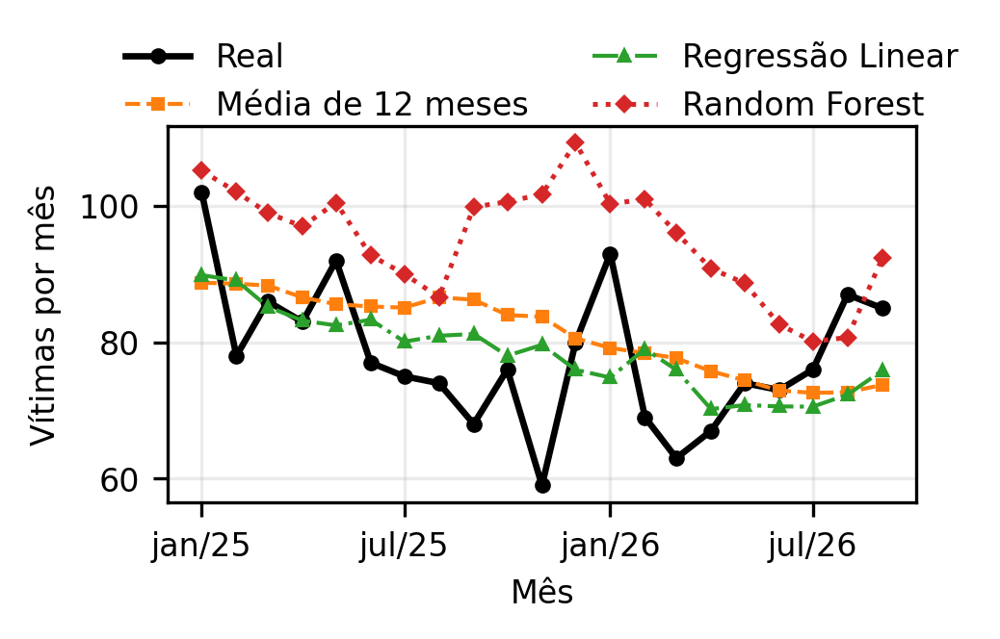

# Previsão Mensal de Vítimas de CVLI em Alagoas com Aprendizado de Máquina

Trabalho da disciplina de Inteligência Artificial (UNIMA, Prof. Marcos Vinícius Silva Bento).
Prevê o número mensal de vítimas de Crimes Violentos Letais Intencionais (CVLI) por município de Alagoas e compara Regressão Linear e Random Forest com modelos de referência simples.

## Integrantes
- Lucas da Silva Santos
- Pollyana de Castro Rodrigues
- Ian Oliveira de Goes Monteiro
- João David Salomão Oliveira do Nascimento

## Perguntas de pesquisa
- **RQ3 (principal):** é possível prever o número mensal de vítimas de CVLI por município de Alagoas?
- **RQ1:** como a distribuição temporal variou e existe sazonalidade?
- **RQ2:** qual a correlação entre população e CVLI?
- **RQ4:** como os municípios podem ser agrupados (K-Means)?

## Dados
- **Vítimas de CVLI:** SSP/AL, base de microdados do portal de dados abertos de Alagoas, baixada em 29/10/2026 (21.615 registros, 01/01/2012 a 30/09/2026).
- **População:** IBGE, Censo 2022 (SIDRA, tabela 4709).
- Os microdados originais **não estão neste repositório**, pois contêm dados pessoais. Para reproduzir a partir deles, baixe o arquivo no portal e salve como `cvli.csv`. A coluna `DATA DO FATO` está em dd/mm/aaaa e deve ser lida com `format="%d/%m/%Y"`.
- `dados/painel.csv`: painel município × mês já tratado, 16.830 linhas (jan/2013 a set/2026), com as colunas `cidade, mes, y, pop, lag1, lag2, lag3, lag6, lag12, roll3, roll12, m, ano, logpop`.

## Estrutura
```
artigo/       artigo em PDF e DOCX
dados/        painel.csv e descrição das colunas
notebooks/    código de cada integrante
figuras/      figuras usadas no artigo
resultados/   tabelas de resultados (.csv)
```

## Como reproduzir
1. `pip install -r requirements.txt`
2. Abra os notebooks de `notebooks/` (Jupyter, VS Code ou Google Colab) e rode do começo ao fim. Todos partem de `dados/painel.csv`.
3. Divisão temporal: treino de jan/2013 a dez/2024 (14.688 linhas) e teste de jan/2025 a set/2026 (2.142 linhas), sem embaralhar. Semente fixa: `random_state=42`.

## Resultados principais

### RQ3: previsão mensal de vítimas por município
Desempenho no período de teste (jan/2025 a set/2026):

| Modelo | MAE | RMSE | Média prevista |
|---|---|---|---|
| Regressão Linear | 0,541 | 1,067 | 0,770 |
| Média de 12 meses | 0,542 | 1,043 | 0,797 |
| Random Forest | 0,614 | 1,077 | 0,932 |
| Ingênuo | 0,627 | 1,359 | 0,770 |
| Sazonal ingênuo | 0,630 | 1,357 | 0,840 |
| Zero sempre | 0,764 | 3,149 | 0,000 |

Média real no teste: 0,764 vítima por município-mês. Nenhum modelo superou de forma clara a média dos 12 meses anteriores.



### Resultados complementares
- **Poisson e municípios grandes × pequenos (Pollyana):** [uma frase com o resultado principal]
- **Sazonalidade (RQ1) e população × CVLI (RQ2) (Ian):** [uma frase com o resultado principal]
- **Grupos de municípios, K-Means (RQ4) (David):** [uma frase com o resultado principal]

## Artigo
[`artigo/artigo.pdf`](artigo/artigo.pdf)

## Licença
- Código: [MIT](LICENSE).
- Dados derivados (`dados/`, `resultados/`): CC BY 4.0, com atribuição à SSP/AL e ao IBGE.

## Aviso sobre dados pessoais
Este repositório contém apenas resultados agregados por município e mês. Não publique nem reenvie os microdados originais.
